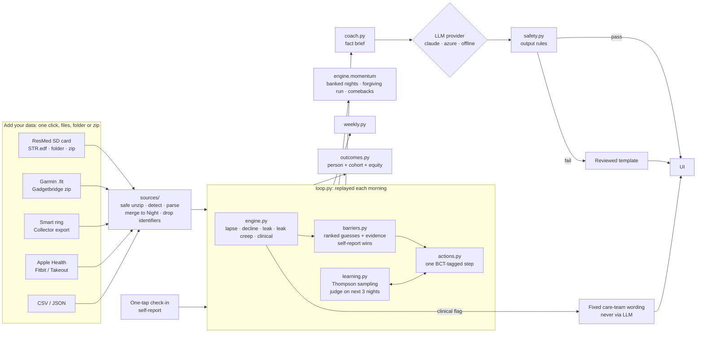

# Architecture

## Design in one line

**Rules decide, the model words, and the person overrides.** Everything that affects health (detection, barrier choice, the step, escalation, clinical flags) is deterministic and testable. The language model only rewrites a fact brief into a friendly note, and its output is checked before anyone sees it.

## Components

| Module | Responsibility | Notes |
|---|---|---|
| `models.py` | `Night`, `CheckIn`, `Profile` | One normalised night shape for every source |
| `ingest.py` | ResMed `STR.edf` reader (approach carried over from Sleep IQ v1), CSV and JSON | Parses in memory. Keeps nightly numbers only; device serial and patient name are dropped. Leak converted from L/s to L/min; ResMed's `-1` "no value" becomes empty |
| `sources/` | One-click ingest: `archive.py` (in-memory zip with guards), detection, `fit.py` (Garmin FIT via `fitdecode`), `wearables.py` (Gadgetbridge DB, Collector ring export, Apple Health, Fitbit), merge with source priority | See [DATA_SOURCES.md](DATA_SOURCES.md) §2 for what each source gives and how it was verified |
| `i18n.py` | Engine messages as `Msg` objects (a `str` in English that can render itself in Arabic) | Detections, barrier evidence, step outcomes, nudge reasons and triggers are all translated |
| `samples.py` | Synthetic sample file for every source (FIT encoder, ResMed-layout EDF writer, SQLite, XML) | Feeds the demo's *Try sample files* and the tests |
| `engine.py` | Night status, five detectors, momentum | All thresholds sit at the top of the file for clinician review |
| `barriers.py` | 13 barriers, 7 inferable from data | Every guess carries evidence; self-report within 3 days outranks data |
| `actions.py` | 29 actions in English and Arabic, BCT-tagged, care-team flag | Library rules: no pressure numbers; comfort settings only "if your care team has made them adjustable" |
| `learning.py` | Beta(helped, not helped) per action, Thompson sampling | Seeded by person, date and barrier, so a replay always gives the same result |
| `loop.py` | Morning-by-morning replay: judge, detect, book lapses, flag, plan, apply the person's choices | At most one new step a day; escalates after two misses; plans nudges |
| `weekly.py` | Monday–Sunday rows: nights, goal met, average hours, leak nights, AHI, lapses and comebacks, steps | |
| `outcomes.py` | Persistence, retention, recovery rate and time, usage and AHI change, steps that helped; groups by attribute | Equity gap counts only groups of 20 or more |
| `coach.py` | Fact brief → provider → safety check → note or template | Brief holds numbers and the chosen step only; no free text from the person goes to the LLM |
| `safety.py` | Bans pressure changes, diagnosis, medication, stopping therapy, blame and links; length cap; crisis keywords (EN and AR) | |
| `llm/` | `claude` (default), `azure`, `offline` behind one interface | Provider picked by `NAFAS_LLM` |
| `server.py` | Flask JSON API plus static UI | State held per browser session, in memory only; uploads up to 64 MB and 2,500 files per request; coach endpoint limited to 20 calls a minute |
| `static/` | One HTML page, plain JS, design tokens | Light and dark, English and Arabic (RTL), checked at 375 px |

## Why replay instead of a database

The loop is a pure function: `(profile, nights, check-ins, choices, date) → state`. Replaying from the first night makes every recommendation reproducible and auditable, so the same inputs always give the same plan. It also gives the timeline slider in the demo for free, and needs no stored state, which helps privacy. A 790-night history replays in about 60 ms. In production the same function runs nightly per user and its output is cached. Nothing about the logic changes.

## API

| Method | Path | Purpose |
|---|---|---|
| GET | `/api/personas` | Demo personas and session uploads |
| GET | `/api/state?persona=&as_of=` | Full state for a morning: night, momentum, detections, barriers, step, recovery, flag, nudge, weekly view, 90-night series, history, learner, outcomes |
| POST | `/api/checkin` | One-tap barrier and optional note; crisis check |
| POST | `/api/action` | `accept` · `swap` · `dismiss` the open step |
| POST | `/api/settings` | Goal, language, nudges, quiet hours, AI wording, care-team sharing (values clamped) |
| POST | `/api/coach` | Evening note through the provider and safety checks |
| GET | `/api/care-team-summary` | Returns 403 unless sharing is on |
| POST | `/api/upload` | Multipart `files` (any mix of files and zips), `paths` (relative paths for folder uploads), `skipped` (files the browser left out, with reasons), `tz_offset_min`. Returns the merged night count plus a report: `found` (one row per source per upload), `skipped` with reason codes, `summary`. **422** with `error: "no_cpap"` when only wearable data came in |
| POST | `/api/upload-samples` | The same path, fed with the synthetic sample files (demo button) |
| POST | `/api/forget` | Deletes everything from the session |
| GET | `/api/cohort` | Synthetic cohort outcome report |

## From prototype to pilot

- **Data in:** today, one-click upload of an SD card, Garmin or Gadgetbridge files, a smart-ring export, Apple Health or Fitbit, from a phone or a PC. For a pilot: the equipment provider's cloud (ResMed AirView or myAir, Philips Care Orchestrator) through a partner agreement, or nightly SD sync from a companion app. The `Night` shape doesn't change.
- **Personal use later (not built):** a later version can read straight from a home hub instead of uploads. The team lead's own hub already stores ring, watch and CPAP nights behind a token-scoped API (an `/ingest/v1` write path and a read tool, `query_readings`). A small `sources/hub.py` adapter would map those documents to `Night` through the same merge. The loop and UI stay as they are; only the "Add your data" step goes away.
- **Hosting:** a stateless container. Keep health data in a UAE region, as UAE health-data rules require. The model provider must be one that can serve from an approved region, or switch to the offline template.
- **Scale:** the loop is O(nights) per person per day, with no cross-user state. Cohort analytics run as a batch job.
- **Channels:** the nudge plan is channel-agnostic. A pilot would add push, WhatsApp or SMS, with the same one-a-day cap and quiet hours.
