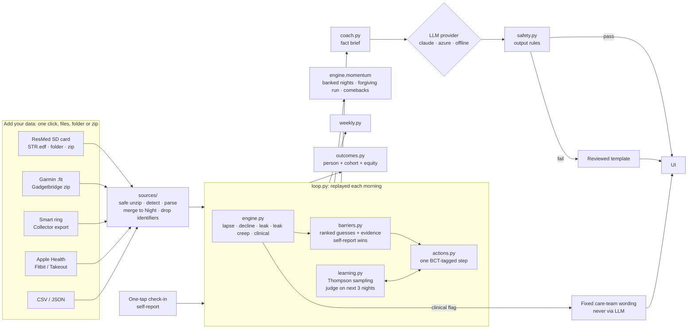

# Architecture

## Design in one line

**Rules decide, the model words, and the person overrides.** Everything that affects health (detection, barrier choice, the step, escalation, clinical flags) is deterministic and testable. The language model only rewrites a fact brief into a friendly note, and its output is checked before anyone sees it.

## Components

| Module | Responsibility | Notes |
|---|---|---|
| `models.py` | `Night`, `CheckIn`, `Profile` | One normalised night shape for every source |
| `ingest.py` | ResMed `STR.edf` reader (approach carried over from Sleep IQ v1), CSV and JSON | Parses in memory. Keeps nightly numbers only; device serial and patient name are dropped. Leak converted from L/s to L/min; ResMed's `-1` "no value" becomes empty |
| `sources/` | One-click ingest: `archive.py` (in-memory zip with guards), detection, `fit.py` (Garmin FIT via `fitdecode`), `wearables.py` (Gadgetbridge DB, Collector ring export, Apple Health, Fitbit), merge with source priority | See [DATA_SOURCES.md](DATA_SOURCES.md) §2 for what each source gives and how it was verified |
| `i18n.py` | Engine messages as `Msg` objects (a `str` in English that can render itself in Arabic) | Detections, barrier evidence, step outcomes, nudge reasons and triggers are all translated |
| `samples.py` | Synthetic sample file for every source (FIT encoder, ResMed-layout EDF writer, SQLite, XML) | Feeds the demo's *Try sample files* and the tests |
| `engine.py` | Night status, five detectors, momentum | All thresholds sit at the top of the file for clinician review |
| `barriers.py` | 13 barriers, 7 inferable from data | Every guess carries evidence; self-report within 3 days outranks data |
| `actions.py` | 29 actions in English and Arabic, BCT-tagged, care-team flag | Library rules: no pressure numbers; comfort settings only "if your care team has made them adjustable" |
| `learning.py` | Beta(helped, not helped) per action, Thompson sampling | Seeded by person, date and barrier, so a replay always gives the same result |
| `loop.py` | Morning-by-morning replay: judge, detect, book lapses, flag, plan, apply the person's choices | At most one new step a day; escalates after two misses; plans nudges |
| `weekly.py` | Monday–Sunday rows: nights, goal met, average hours, leak nights, AHI, lapses and comebacks, steps | |
| `outcomes.py` | Persistence, retention, recovery rate and time, usage and AHI change, steps that helped; groups by attribute | Equity gap counts only groups of 20 or more |
| `coach.py` | Fact brief → provider → safety check → note or template | Brief holds numbers and the chosen step only; no free text from the person goes to the LLM |
| `qa.py` | Ask about your data. **In:** emergency → emergency message; clinical decision (pressure, medication, diagnosis, stopping) → fixed care-team answer; neither reaches the model. **Model:** answers only from a numbers-only fact pack (last 14 nights, 8 weeks, progress, current step, lapses). **Out:** safety rules (pressure *advice* blocked, values allowed), every number must match the facts (rounding allowed), length cap, cut-off answers rejected; any failure → fixed data summary | Replies in the language of the question. Benchmarked (31 cases) and checked live (`scripts/qa_eval.py`) |
| `safety.py` | Bans pressure changes, diagnosis, medication, stopping therapy, blame and links; length cap. Emergency wording in notes (EN + AR, normalised spelling, simple negation) | Benchmarked: sensitivity 100% on 47 phrasings ([BENCHMARK.md](BENCHMARK.md)) |
| `quality.py` | Data checks on every upload: impossible values, suspect units, duplicates, gaps, missing fields, conflicting sources | Every problem is a warning naming the checks it turns off; never a crash or a silent drop. Stops only when nightly usage is missing everywhere |
| `benchmark.py` | 129 labelled cases (89 hard) across emergency wording, the care-team flag, detectors and barriers | Each failure names its module; `scripts/benchmark.py` writes the results |
| `llm/` | `claude` (default), `gemini` (Vertex AI via gcloud token, or AI Studio key), `azure`, `offline` behind one interface | Provider picked by `NAFAS_LLM`; Gemini safety blocks and cut-off answers become errors, so the template is shown |
| `server.py` | Flask JSON API plus static UI | State held per browser session, in memory only; uploads up to 64 MB and 2,500 files per request; coach endpoint limited to 20 calls a minute |
| `static/` | One HTML page, plain JS, design tokens | Light and dark, English and Arabic (RTL), checked at 375 px |

## Why replay instead of a database

The loop is a pure function: `(profile, nights, check-ins, choices, date) → state`. Replaying from the first night makes every recommendation reproducible and auditable, so the same inputs always give the same plan. It also gives the timeline slider in the demo for free, and needs no stored state, which helps privacy. A 790-night history replays in about 60 ms. In production the same function runs nightly per user and its output is cached. Nothing about the logic changes.

## API

| Method | Path | Purpose |
|---|---|---|
| GET | `/api/personas` | Demo personas and session uploads |
| GET | `/api/state?persona=&as_of=` | Full state for a morning: night, momentum, detections, barriers, step, recovery, flag, nudge, weekly view, 90-night series, history, learner, outcomes |
| POST | `/api/checkin` | One-tap barrier and optional note; crisis check |
| POST | `/api/action` | `accept` · `swap` · `dismiss` the open step |
| POST | `/api/settings` | Goal, language, nudges, quiet hours, AI wording, care-team sharing (values clamped) |
| POST | `/api/coach` | Evening note through the provider and safety checks |
| GET | `/api/care-team-summary` | Returns 403 unless sharing is on |
| POST | `/api/upload` | Multipart `files` (any mix of files and zips), `paths` (relative paths for folder uploads), `skipped` (files the browser left out, with reasons), `tz_offset_min`. Returns the merged night count plus a report: `found` (one row per source per upload), `skipped` with reason codes, `summary`. **422** with `error: "no_cpap"` when only wearable data came in |
| POST | `/api/upload-samples` | The same path, fed with the synthetic sample files (demo button) |
| POST | `/api/forget` | Deletes everything from the session |
| GET | `/api/cohort` | Synthetic cohort outcome report |

## Data checks: flag, don't crash, don't guess

| Problem | What Nafas does | The person sees |
|---|---|---|
| Nightly usage missing on some nights | Leaves those nights out (can't tell used from not used) | A warning with the count |
| Nightly usage missing everywhere | **Stops**: every decision needs it | What's missing and which column to add |
| Impossible value (AHI 999, leak −5, pressure 60) | Ignores that value; the night still counts | A warning naming the field and the checks it affects |
| Impossible usage (over 24 h) | Counts the night as not used (the conservative reading) | A warning |
| Hours in a minutes column, L/s in an L/min column | **Doesn't convert on a guess**: a wrong guess could hide a lapse or invent a leak. `usage_hours` and `leak95_lps` columns are converted exactly | A warning saying which column name to use |
| Duplicate nights | Keeps the most complete record | A warning with the dates |
| Two sources disagree on a night | SD card wins over CSV/JSON | A warning with the count |
| Gap of 7 nights or more | Counts as not used (a lapse is the safe assumption) | "If you did use CPAP, the card copy may be incomplete" |
| A field missing everywhere (AHI, leak, start time, mask events, wearable) | Turns off only the checks that need it | Which check is off, and why it matters |
| Readings on a 0-minute night | Dropped as noise | — |

Warnings appear in the upload's "what we found" panel and on the Today page for uploaded data, in English or Arabic.

## Integration with existing systems (described, not built)

The Department of Health speaker at the webinar put weight on *ease of integration*. Nafas is built to sit next to existing systems, not replace them:

- **JSON API, today.** Every view in the UI is a JSON endpoint (see API above): the state for any morning, the weekly view, outcomes and the consent-gated care-team summary. A clinic portal or patient app can call these directly, and the UI is just one client.
- **Provider cloud feeds, for a pilot.** Equipment providers already hold nightly data in ResMed AirView or Philips Care Orchestrator. A partner export (daily CSV or API) maps straight onto `Night`, the same shape the SD-card reader produces. The data checks run unchanged. AirView finds the patient at risk; Nafas gives that patient a reason, a step and a comeback between calls.
- **FHIR export (idea).** The care-team summary maps naturally onto HL7 FHIR R4:
  - one `Observation` per night for usage, residual AHI and leak, with `effectiveDateTime` as the night and `device` referencing the CPAP;
  - one `Observation` per week for adherence %;
  - a `Flag` for the high-residual-AHI pattern;
  - a `Communication` for the person's own note, only with consent.

  Codes (LOINC or SNOMED CT, else a local code system) would be agreed with the pilot partner and the Malaffi / Abu Dhabi health-information exchange profile, not invented here.

## From prototype to pilot

- **Data in:** today, one-click upload of an SD card, Garmin or Gadgetbridge files, a smart-ring export, Apple Health or Fitbit, from a phone or a PC. For a pilot: the equipment provider's cloud (ResMed AirView or myAir, Philips Care Orchestrator) through a partner agreement, or nightly SD sync from a companion app. The `Night` shape doesn't change.
- **Personal mode (built, off by default):** `python run.py --port 5058 --hub <path to hub.db>` adds a "My data (hub)" persona. It reads a home hub's SQLite store read-only (no upload, no token) and re-reads whenever the store changes.
  - It takes CPAP nights plus any ring or watch sleep (`sources/hub.py`), through the same data checks and merge as uploads.
  - Without `--hub` (or `NAFAS_PERSONAL_HUB=1` + `NAFAS_HUB_DB`), nothing changes: the demo and the repo hold no personal data.
- **Hosting:** a stateless container. Keep health data in a UAE region, as UAE health-data rules require. The model provider must be one that can serve from an approved region, or switch to the offline template.
- **Scale:** the loop is O(nights) per person per day, with no cross-user state. Cohort analytics run as a batch job.
- **Channels:** the nudge plan is channel-agnostic. A pilot would add push, WhatsApp or SMS, with the same one-a-day cap and quiet hours.
